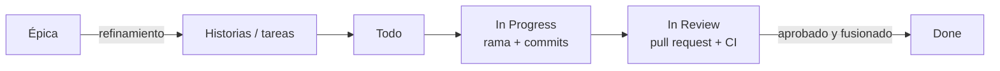

# Cómo trabajamos en zBooks

Equipo: **zStrikke** (product owner y desarrollador) y **Claude** (desarrollador y arquitecto).

## 1. Del backlog al código

- **Épicas:** agrupan el trabajo de una iteración futura. Llevan la etiqueta `necesita refinamiento`.
- **Refinamiento:** antes de empezar una iteración, PO y Claude dividen su épica en historias con criterios de aceptación.
- **Historias y tareas:** se crean con las plantillas de issue y cada una pertenece a un hito (versión).

## 2. Tablero (GitHub Projects)

Columnas: **Backlog → Todo → In Progress → In Review → Done**.

| Columna | Qué hay |
|---|---|
| Backlog | Todo lo que no es de la iteración actual |
| Todo | Issues de la iteración actual, listas para empezar |
| In Progress | Alguien está trabajando en ella (tiene rama) |
| In Review | Tiene un PR abierto |
| Done | PR fusionado e issue cerrada |

## 3. Ramas

- `master` siempre funciona y está protegida: solo se cambia mediante pull request con la CI en verde.
- Una rama por issue, con su número:

| Tipo | Formato | Ejemplo |
|---|---|---|
| Funcionalidad | `feature/<nº>-<descripcion>` | `feature/18-zona-habitual` |
| Corrección | `fix/<nº>-<descripcion>` | `fix/42-zbid-duplicado` |
| Documentación | `docs/<nº>-<descripcion>` | `docs/3-plantillas-contribucion` |
| Tarea técnica | `chore/<nº>-<descripcion>` | `chore/7-ci-github-actions` |

## 4. Commits convencionales

Formato: `tipo(ámbito opcional): descripción en minúscula`

| Tipo | Uso |
|---|---|
| `feat` | Nueva funcionalidad |
| `fix` | Corrección de un error |
| `docs` | Documentación |
| `test` | Tests |
| `refactor` | Cambio interno sin cambiar el comportamiento |
| `chore` | Configuración, dependencias, CI |

Ejemplos: `feat(auth): verificación de email en el registro` · `fix(geo): radio en metros en ST_DWithin`

## 5. Pull requests

**Antes de abrir un PR**, `make check` tiene que pasar. Hace lo mismo que la CI:

| Comando | Qué hace | Herramienta |
|---|---|---|
| `make lint` | Comprueba el estilo sin cambiar nada | Pint (preset `laravel`) |
| `make format` | Corrige el estilo | Pint |
| `make analyse` | Análisis estático: tipos, métodos inexistentes, errores de Eloquent | Larastan, nivel 6 |
| `make test` | Tests contra PostgreSQL + PostGIS (`zbooks_testing`), nunca SQLite | Pest |
| `make check` | Los tres anteriores, en ese orden | |

Los tests viven en `tests/Feature` (peticiones HTTP y base de datos), `tests/Unit` (clases sueltas, sin framework) y `tests/Arch` (reglas sobre el código: nada de `dd()`, `env()` solo en `config/`…).

- Título con formato de commit convencional.
- Cuerpo con la plantilla: qué cambia, `Closes #nº`, cómo probarlo y la checklist de la DoD.
- El PO revisa y comenta en las líneas concretas. Claude responde en el mismo hilo y sube los cambios a la misma rama.
- Se fusiona cuando el PO aprueba y la CI está en verde.

## 6. Versiones y CHANGELOG

- [SemVer](https://semver.org/lang/es/): cada iteración cerrada es una versión menor (`v0.1.0`, `v0.2.0`…).
- Al cerrar una iteración: se actualiza `CHANGELOG.md`, se crea la etiqueta `vX.Y.Z` y una *release* en GitHub.

## 7. Documentación viva

| Qué | Dónde | Cuándo |
|---|---|---|
| Diario de desarrollo | [`docs/DIARIO.md`](docs/DIARIO.md) | Una entrada por sesión |
| Decisiones de arquitectura | [`docs/adr/`](docs/adr/) | Al tomar una decisión importante |
| Diagramas | [`docs/diagramas/`](docs/diagramas/) | En el mismo PR que cambia el diseño |
| Retrospectiva | En el diario | Al cerrar cada iteración |
