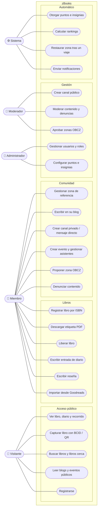

# 01 · Casos de uso

Mermaid no tiene diagrama de casos de uso nativo; se representa con un diagrama de flujo: actores a los lados, casos de uso (óvalos) agrupados por módulo dentro del sistema.

Los roles son acumulativos: un Moderador puede hacer todo lo del Miembro, y el Administrador todo lo del Moderador.

## Notas

- **Capturar** está en el acceso público porque un visitante sin cuenta puede registrar una captura anónima (RF-13).
- **Mensaje directo** es un canal privado de dos personas (ADR-0005).
