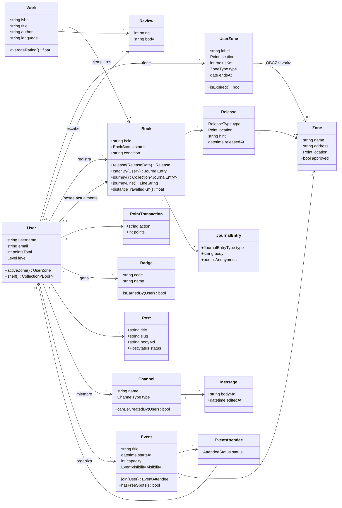
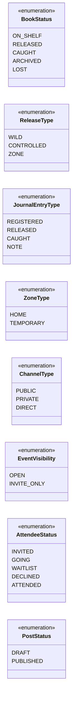

# 02 · Modelo de dominio

Vista de clases a nivel de código: modelos Eloquent con sus atributos principales y métodos de dominio. Se omiten timestamps, ids y relaciones triviales de Laravel.

## Enums (PHP 8.1+)

## Decisiones reflejadas

- **Obra vs ejemplar:** `Work` es el título (ISBN) y `Book` cada copia física con su BCID. Las reseñas cuelgan de `Work`; el diario, de `Book`.
- **Puntos como libro de cuentas:** `PointTransaction` es inmutable y `User.pointsTotal` es un total cacheado que siempre se puede recalcular (ADR-0004).
- **Geometrías:** `Point` y `LineString` son objetos de valor de PostGIS (paquete `clickbar/laravel-magellan`), no pares de floats.
- **Lógica en el dominio:** métodos como `Book::release()` o `Event::join()` delegarán en clases *Action* para mantener los modelos delgados.
