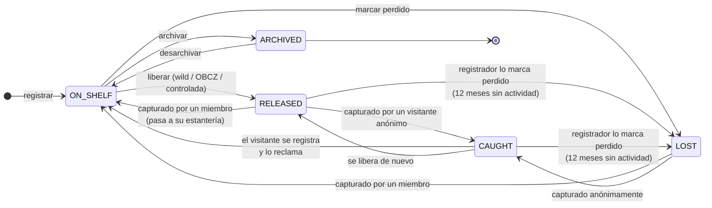

# 03 · Estados del ejemplar (`BookStatus`)

## Significado de cada estado

| Estado | Significado | Poseedor (`current_holder_id`) |
|---|---|---|
| `ON_SHELF` | En la estantería de un miembro, no liberado | El miembro |
| `RELEASED` | Liberado, esperando a ser encontrado (o en camino a un destinatario) | `null` |
| `CAUGHT` | Encontrado por alguien **sin cuenta** | `null` (desconocido) |
| `LOST` | Se da por perdido; se puede recuperar si alguien lo captura | `null` |
| `ARCHIVED` | Retirado por su poseedor (deteriorado, se lo queda…) | El miembro |

## Reglas

- Solo el **poseedor actual** puede liberar o archivar (Policy).
- **Marcar como perdido:**
  - Desde `ON_SHELF`: el poseedor actual, en cualquier momento.
  - Desde `RELEASED` o `CAUGHT`: el **registrador original**, cuando han pasado **12 meses** sin entradas de diario.
  - Una tarea programada avisa al registrador cuando su libro cumple esos 12 meses.
- Una liberación **controlada** (a un destinatario) sigue siendo `RELEASED` hasta que el destinatario confirma la captura.
- Cada transición genera una `JournalEntry`. El estado actual es una caché de la última entrada relevante.

## Decisiones del PO

- [x] Un libro liberado se puede marcar como perdido tras **12 meses** sin actividad.
- [x] Lo puede marcar el **registrador original**, aunque ya no sea el poseedor.
