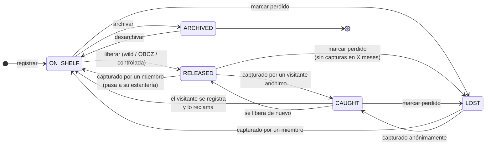

# 03 · Estados del ejemplar (`BookStatus`)

## Significado de cada estado

| Estado | Significado | Poseedor (`current_holder_id`) |
|---|---|---|
| `ON_SHELF` | En la estantería de un miembro, no liberado | El miembro |
| `RELEASED` | Liberado, esperando a ser encontrado (o en camino a un destinatario) | `null` |
| `CAUGHT` | Encontrado por alguien **sin cuenta** | `null` (desconocido) |
| `LOST` | Se da por perdido; se puede recuperar si alguien lo captura | `null` |
| `ARCHIVED` | Retirado por su poseedor (deteriorado, se lo queda…) | El miembro |

## Reglas

- Solo el **poseedor actual** puede liberar, archivar o marcar como perdido (Policy).
- Una liberación **controlada** (a un destinatario) sigue siendo `RELEASED` hasta que el destinatario confirma la captura.
- Cada transición genera una `JournalEntry`. El estado actual es una caché de la última entrada relevante.

## Pendiente de validar (PO)

- [ ] ¿Pasados cuántos meses sin capturas se ofrece marcar un libro liberado como perdido?
- [ ] ¿Puede el **registrador original** (no poseedor) marcarlo como perdido?
