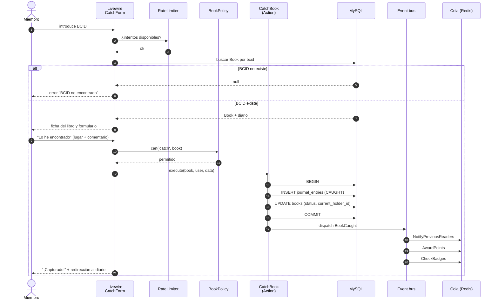

# 04 · Secuencia: capturar un libro (CU-03)

Caso: un **miembro** encuentra un libro e introduce su BCID.

## Variante: visitante anónimo

Igual hasta el paso de captura, con estas diferencias:
- No hay `user`; la entrada se guarda con `is_anonymous = true` y el estado pasa a `CAUGHT`.
- No se otorgan puntos al visitante, **sí** al registrador (+5).
- Se muestra una invitación a registrarse para reclamar el libro.

## Puntos clave

- **Transacción:** diario y estado del libro se actualizan juntos o no se actualizan.
- **Lo lento va a la cola:** emails, puntos e insignias no retrasan la respuesta al usuario.
- **Rate limiting** antes de consultar la BD para dificultar que se adivinen BCIDs.
