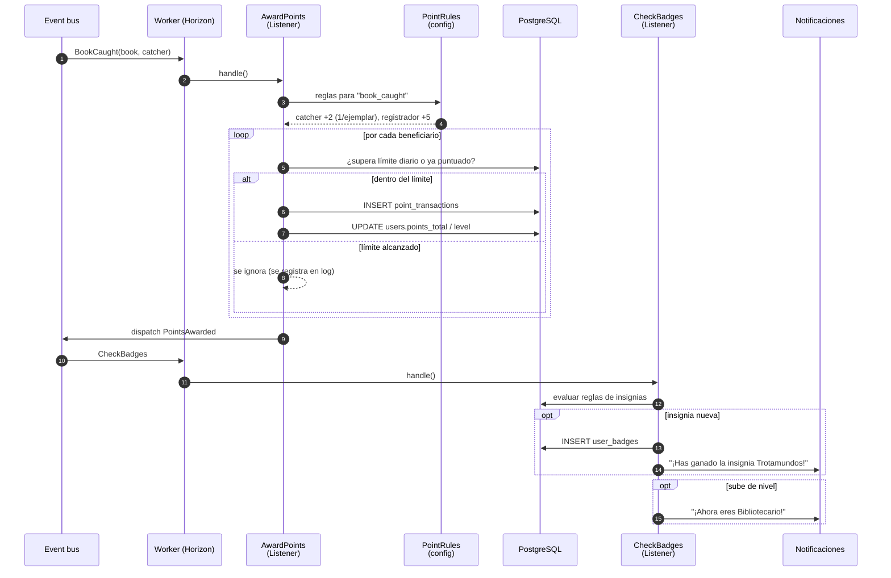

# 05 · Secuencia: otorgar puntos e insignias

Se dispara con cualquier evento de dominio que puntúa (`BookRegistered`, `BookReleased`, `BookCaught`, `ReviewPublished`, `EventAttendanceConfirmed`…). Ejemplo con `BookCaught`.

## Puntos clave

- **Idempotencia:** si el worker reintenta el trabajo, no se duplican puntos (clave única por acción + sujeto + usuario).
- **Libro de cuentas inmutable:** nunca se edita una transacción; las correcciones son transacciones negativas.
- **Rankings:** no se calculan aquí sino con una tarea programada que agrega `point_transactions` del mes.
