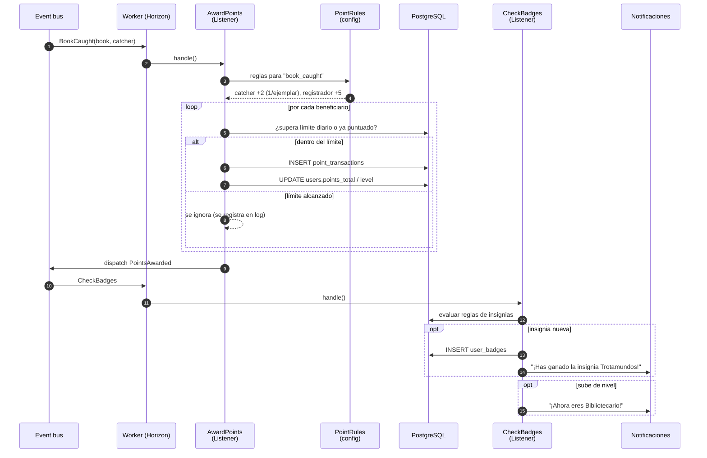

# 05 · Secuencia: otorgar puntos e insignias

Se dispara con cualquier evento de dominio que puntúa (`BookRegistered`, `BookReleased`, `BookCaught`, `ReviewPublished`, `EventAttendanceConfirmed`…). Ejemplo con `BookCaught`.

## Casos típicos relatados

### 1. Una captura que da insignia
Marcos captura en Lisboa un libro de Lucía. El evento `BookCaught` llega al worker (pasos 1–2) y las reglas devuelven dos beneficiarios (pasos 3–4). Marcos no había capturado nunca ese ejemplar: +2. Lucía recibe +5, porque los puntos importantes van a quien hizo circular el libro (pasos 5–7). Después, `CheckBadges` comprueba las insignias (pasos 9–14). Con Portugal, el libro de Lucía ya ha pasado por 5 países, así que gana la insignia **Trotamundos** y recibe una notificación.

### 2. El worker se cae a mitad
El worker guarda la transacción de Marcos y, justo antes de terminar, se reinicia el contenedor. Horizon reintenta el trabajo desde el principio. Al intentar insertar de nuevo los puntos de Marcos, la `idempotency_key` (`book_caught:{book}:{user}`) ya existe y la inserción se omite. Los puntos de Lucía, que no llegaron a guardarse, se guardan ahora. Resultado: cada uno tiene sus puntos una sola vez.

### 3. Inventariar una biblioteca entera
Carlos se da de alta y registra 25 libros en una tarde para inventariar su biblioteca. Los 10 primeros le dan +1 cada uno. A partir del undécimo, el límite diario está alcanzado (pasos 5 y 8): el libro se registra igual, pero no puntúa y queda anotado en el log. Así se premia participar sin incentivar el registro masivo de libros que nunca circularán.

## Puntos clave

- **Idempotencia:** si el worker reintenta el trabajo, no se duplican puntos (clave única por acción + sujeto + usuario).
- **Libro de cuentas inmutable:** nunca se edita una transacción; las correcciones son transacciones negativas.
- **Rankings:** no se calculan aquí sino con una tarea programada que agrega `point_transactions` del mes.
