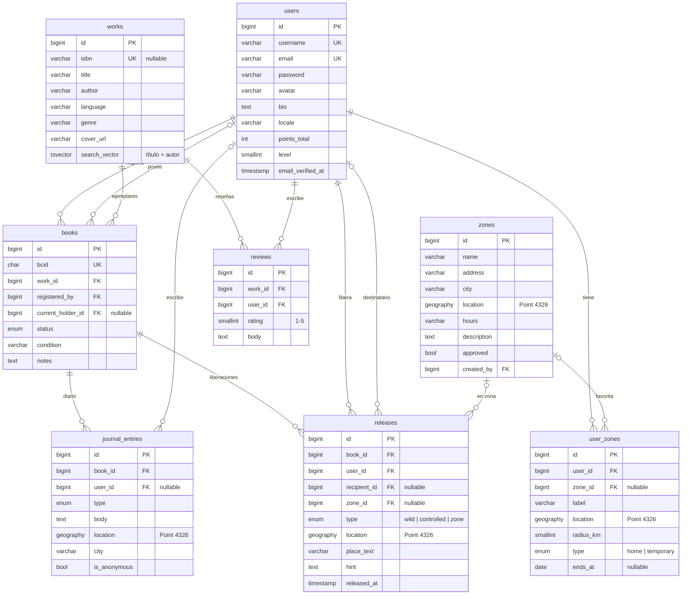
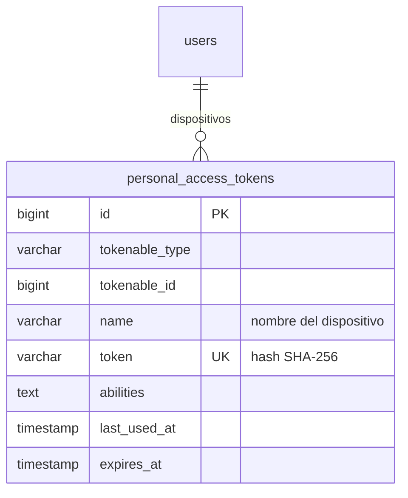
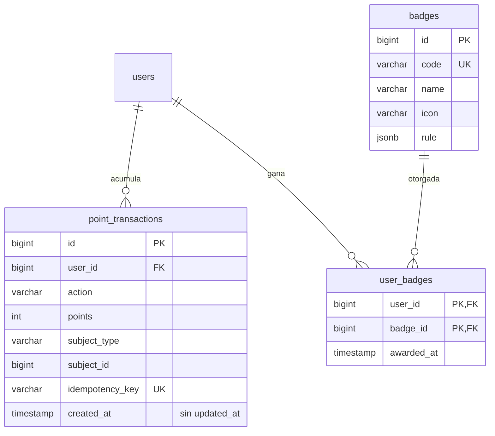
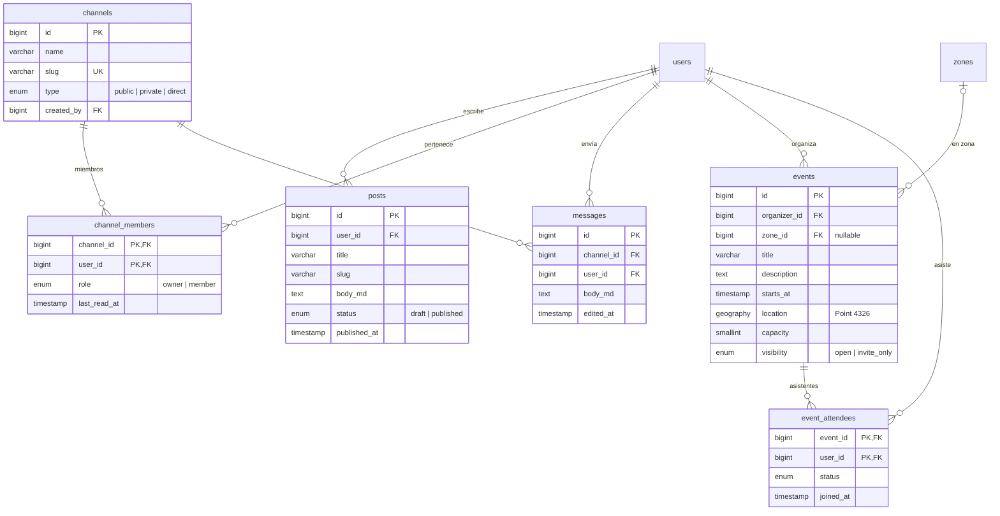

# 06 · Diagrama entidad-relación

Diseño previsto de **PostgreSQL 16 + PostGIS 3** (ADR-0006). Las coordenadas se guardan como `geography(Point, 4326)` (WGS84, distancias en metros). Para que los diagramas se lean mejor, se omiten `created_at`, `updated_at` y `deleted_at` (ver [Marcas de tiempo y borrado lógico](#marcas-de-tiempo-y-borrado-lógico)) y las tablas de paquetes (roles de spatie, `notifications`, `jobs`, `sessions`…).

## Núcleo: usuarios, libros y viaje

## Autenticación API

## Gamificación

## Comunidad

## Social, importación y moderación

## Marcas de tiempo y borrado lógico

| Tablas | Timestamps | Soft delete | Motivo |
|---|---|---|---|
| `books`, `works` | ✔ | ✔ | Un BCID nunca desaparece; su historial se conserva |
| `journal_entries`, `reviews`, `posts`, `messages` | ✔ | ✔ | La moderación oculta contenido sin perder el rastro |
| `zones`, `events`, `channels` | ✔ | ✔ | Pueden tener datos asociados (liberaciones, asistentes, mensajes) |
| `releases`, `user_zones`, `wishlists`, `follows`, `imports`, `reports` | ✔ | ✘ | Borrado real; el historial relevante vive en el diario |
| `point_transactions` | solo `created_at` | ✘ | Inmutable: las correcciones son transacciones negativas |
| `badges` | ✔ | ✘ | Catálogo gestionado desde el admin |
| `user_badges`, `channel_members`, `event_attendees` | sus propias fechas (`awarded_at`, `joined_at`, `last_read_at`) | ✘ | Tablas de relación |
| `users` | ✔ | ✘ → **anonimización** | El RGPD exige borrar datos personales de verdad. Se anonimiza la cuenta y se conserva el historial de los libros. |

**Implementación:**
- `$table->timestamps()` / `$table->softDeletes()` en las migraciones y el trait `SoftDeletes` en el modelo.
- `point_transactions` usa `public const UPDATED_AT = null;`.
- Los índices únicos de tablas con soft delete deben tenerlo en cuenta (p. ej. índice parcial `WHERE deleted_at IS NULL`).

## Índices y restricciones relevantes

| Tabla | Índice / restricción | Motivo |
|---|---|---|
| `books` | `UNIQUE(bcid)` | Búsqueda por BCID y unicidad |
| `reviews` | `UNIQUE(work_id, user_id)` + `CHECK(rating BETWEEN 1 AND 5)` | Una reseña por obra y usuario |
| `point_transactions` | `UNIQUE(idempotency_key)` | No duplicar puntos en reintentos |
| `releases`, `journal_entries`, `zones`, `events`, `user_zones` | `GIST(location)` | Búsquedas por cercanía (`ST_DWithin`) |
| `works` | `GIN(search_vector)` | Búsqueda de texto completo |
| `user_zones` | `UNIQUE(user_id) WHERE type = 'home'` (índice parcial) | Una sola zona habitual por usuario |
| `channel_members`, `event_attendees` | PK compuesta | Pertenencia única |
| `event_attendees` | `INDEX(event_id, status)` | Contar plazas y lista de espera |

## Consultas geoespaciales previstas

| Necesidad | PostGIS |
|---|---|
| Libros liberados cerca de mi zona | `ST_DWithin(r.location, :centro, :radio_m)` |
| Distancia a cada libro | `ST_Distance(r.location, :centro)` |
| Ruta del recorrido | `ST_MakeLine(location::geometry ORDER BY fecha)` |
| Km recorridos | `ST_Length(ruta::geography) / 1000` |
| Salida para el mapa y la API | `ST_AsGeoJSON(...)` (RFC 7946) |
