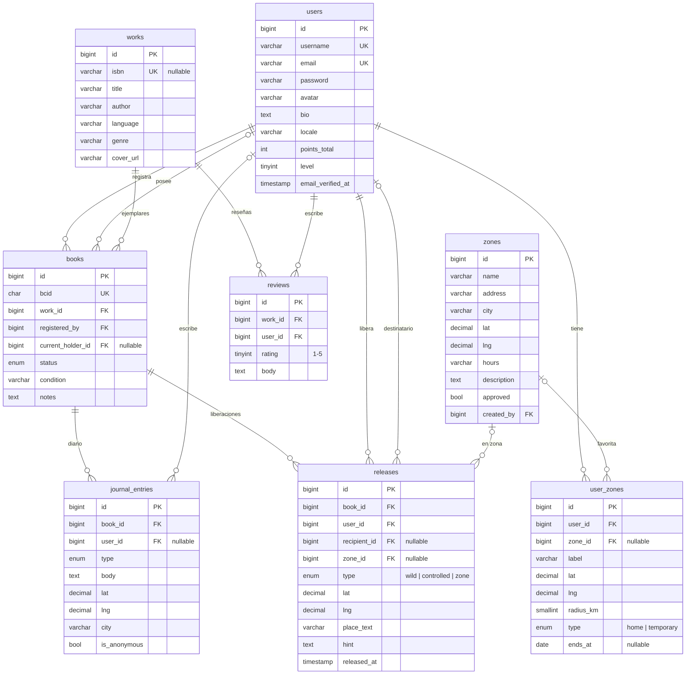
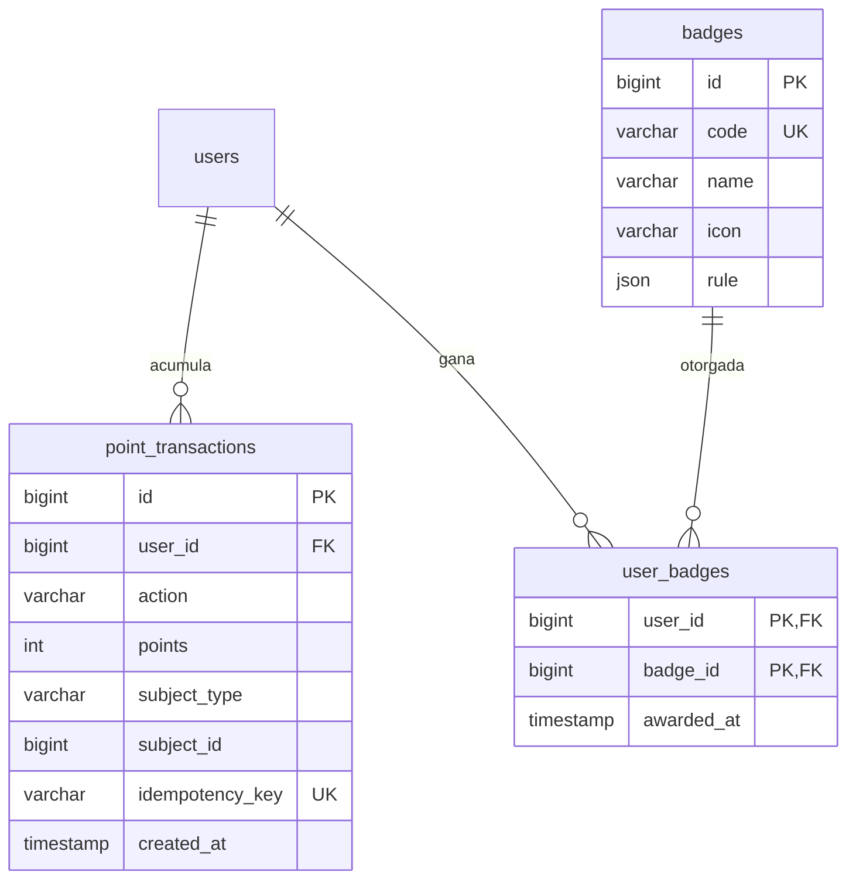
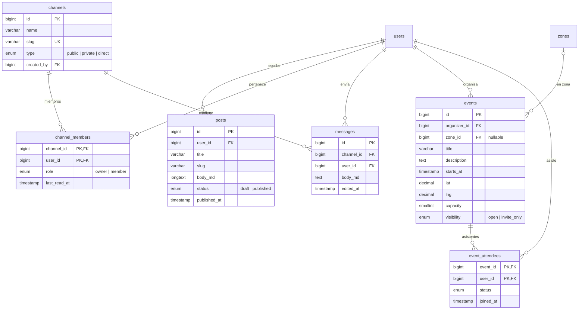
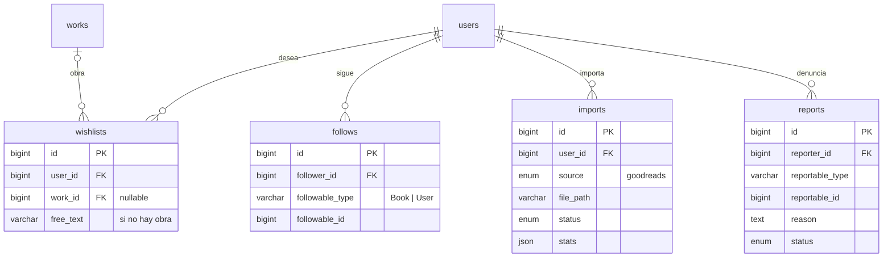

# 06 · Diagrama entidad-relación

Diseño previsto de MySQL. Se omiten `created_at`, `updated_at`, `deleted_at` y las tablas de paquetes (roles de spatie, `notifications`, `jobs`, `sessions`…).

## Núcleo: usuarios, libros y viaje

## Gamificación

## Comunidad

## Social, importación y moderación

## Índices y restricciones relevantes

| Tabla | Índice / restricción | Motivo |
|---|---|---|
| `books` | `UNIQUE(bcid)` | Búsqueda por BCID y unicidad |
| `reviews` | `UNIQUE(work_id, user_id)` | Una reseña por obra y usuario |
| `point_transactions` | `UNIQUE(idempotency_key)` | No duplicar puntos en reintentos |
| `releases`, `zones`, `events` | `INDEX(lat, lng)` o columna `POINT` + `SPATIAL INDEX` | Búsquedas por cercanía (se decidirá en It. 4) |
| `user_zones` | `INDEX(user_id, type)` | Obtener zona activa |
| `channel_members` | PK compuesta | Pertenencia única |
| `event_attendees` | PK compuesta + `INDEX(event_id, status)` | Contar plazas y lista de espera |
