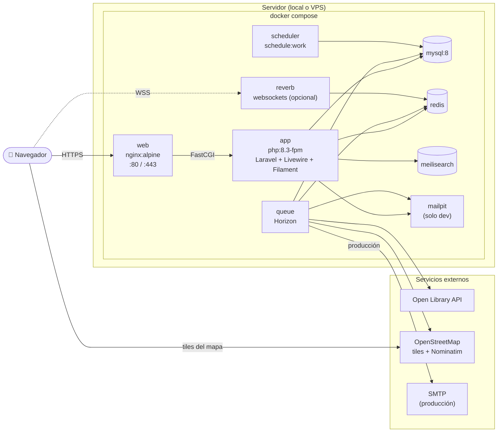

# 07 · Despliegue (Docker Compose)

## Notas

- `app`, `queue`, `scheduler` y `reverb` comparten la **misma imagen**; solo cambia el comando de arranque.
- MySQL, Redis y Meilisearch usan **volúmenes** para persistir datos.
- En desarrollo, `node` (Vite) corre aparte para recompilar CSS/JS en caliente; no está en producción.
- Las llamadas a APIs externas van **por la cola** y con caché, para no depender de su disponibilidad.
