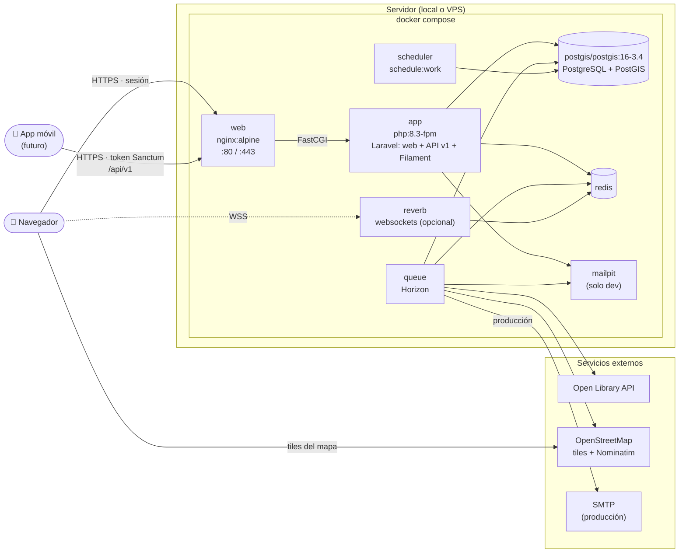

# 07 · Despliegue (Docker Compose)

## Notas

- `app`, `queue`, `scheduler` y `reverb` comparten la **misma imagen**; solo cambia el comando de arranque.
- PostgreSQL y Redis usan **volúmenes** para persistir datos.
- La búsqueda de texto usa el full-text de PostgreSQL; Meilisearch queda como opción futura si hiciera falta.
- Web y móvil entran por el mismo nginx: la web con sesión y cookies, el móvil con token Bearer en `/api/v1`.
- En desarrollo, `node` (Vite) corre aparte para recompilar CSS/JS en caliente; no está en producción.
- Las llamadas a APIs externas van **por la cola** y con caché, para no depender de su disponibilidad.
