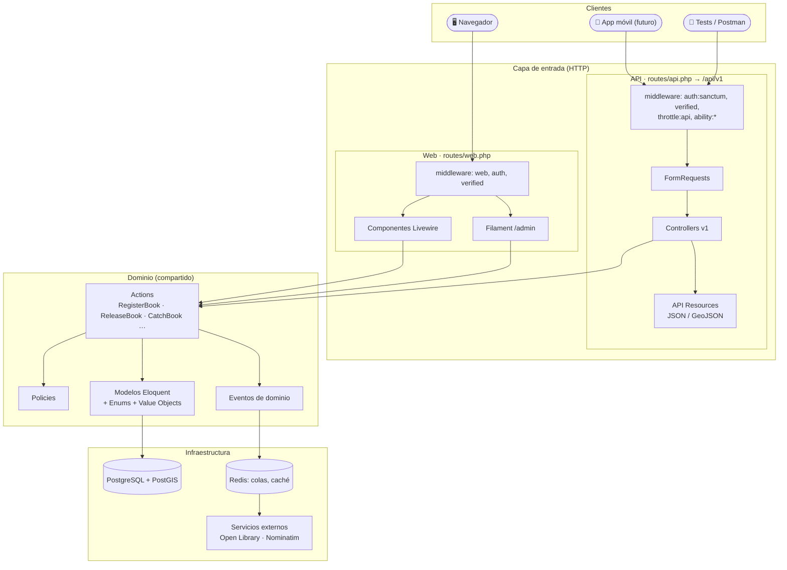

# 08 · Arquitectura: web y API sobre el mismo dominio

La web (Livewire) y la API REST (`/api/v1`) son **dos puertas de entrada** al mismo núcleo. Ninguna lógica de negocio vive en controladores ni componentes: ambos delegan en *Actions* (ADR-0007).

## Convenciones de la API v1

| Aspecto | Convención |
|---|---|
| Versionado | En la URL: `/api/v1/...`. Un cambio incompatible crea `/api/v2`; la v1 se mantiene un tiempo marcada como *deprecated* (cabecera `Sunset`). |
| Recursos | Sustantivos en plural y en inglés: `/books`, `/books/{bcid}/journal`, `/zones`, `/events`. |
| Formato | JSON con `data` / `meta` / `links`. Endpoints de mapa en **GeoJSON** (RFC 7946). |
| Errores | *Problem Details* (RFC 9457): `type`, `title`, `status`, `detail`, `errors`. |
| Paginación | Por cursor en listados largos (`?cursor=`), por páginas en el resto. |
| Filtros y orden | `?filter[language]=es&sort=-released_at` (spatie/laravel-query-builder). |
| Autenticación | `Authorization: Bearer <token>` (Sanctum), un token por dispositivo con *abilities*. |
| Límites | `throttle:api` (60/min por usuario), más estricto en login y captura de BCID. |
| Documentación | OpenAPI 3.1 generado con **Scramble** en `/docs/api`. |
| Tests | Cada endpoint con tests de contrato (Pest): estructura, códigos de estado, permisos. |

## Ejemplos de endpoints

| Método | Ruta | Descripción |
|---|---|---|
| `POST` | `/api/v1/auth/register` | Registro (envía email de verificación) |
| `POST` | `/api/v1/auth/token` | Login → token para `device_name` |
| `DELETE` | `/api/v1/auth/token` | Cerrar sesión en este dispositivo |
| `GET` | `/api/v1/books/{bcid}` | Ficha del ejemplar |
| `GET` | `/api/v1/books/{bcid}/journey` | Recorrido en GeoJSON (`LineString` + `Point`s) |
| `POST` | `/api/v1/books/{bcid}/catches` | Capturar un libro |
| `POST` | `/api/v1/books/{bcid}/releases` | Liberar un libro |
| `GET` | `/api/v1/releases/nearby?lat=&lng=&radius=` | Libros cerca (GeoJSON `FeatureCollection`) |
| `GET` | `/api/v1/me/shelf` | Mi estantería |
