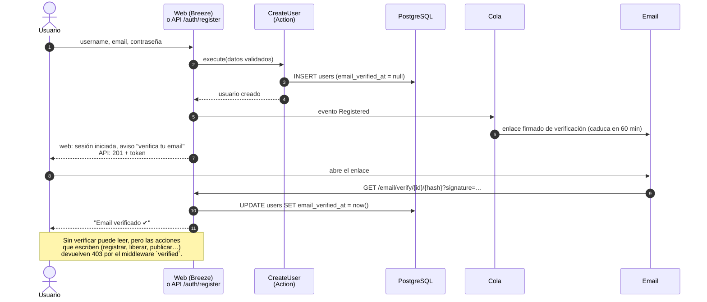
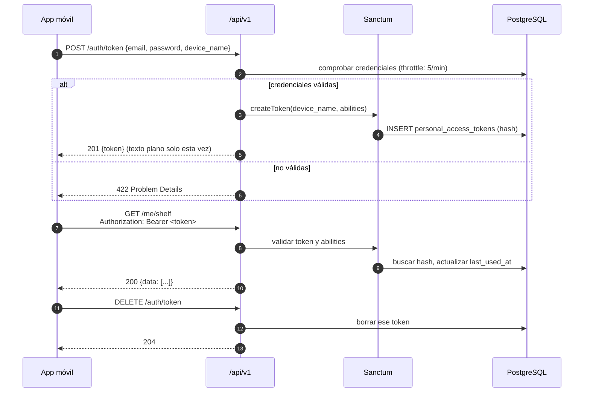

# 09 · Secuencia: registro, verificación y acceso (web y API)

Una misma cuenta, dos formas de identificarse (ADR-0008): **sesión** en la web y **token Sanctum** en la API.

## Registro y verificación por email

## Acceso desde la API (móvil)

## Notas

- La web **no** usa Sanctum: Livewire en el mismo dominio funciona con la sesión estándar de Laravel.
- Desde su perfil, el usuario ve sus dispositivos conectados y puede revocar cualquier token.
- Los tokens caducan (p. ej. 90 días sin uso) para limitar daños si se pierde un móvil.
